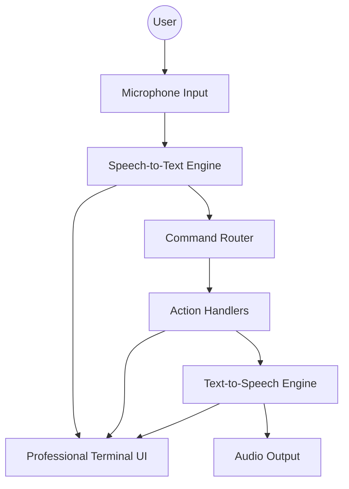
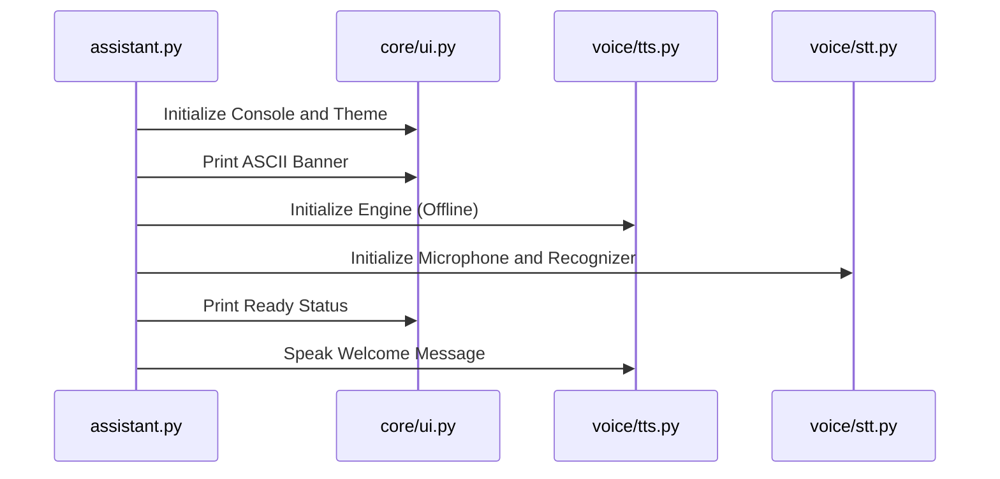
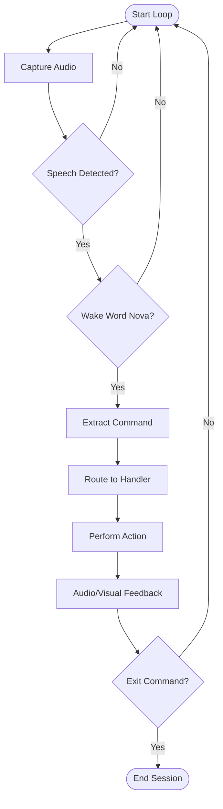
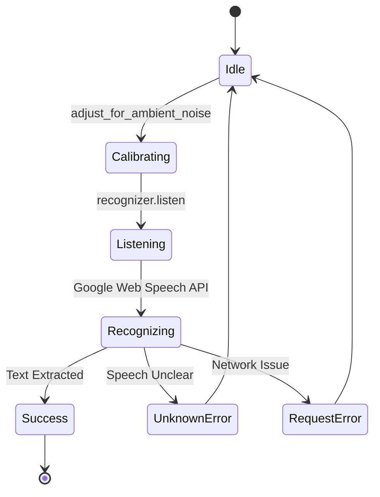
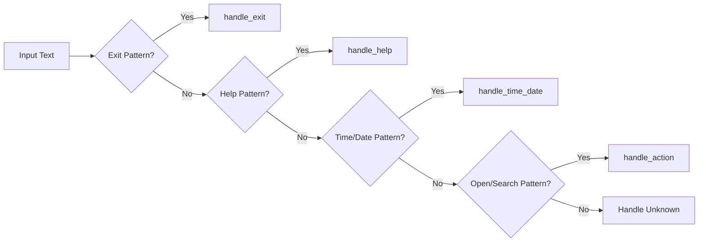
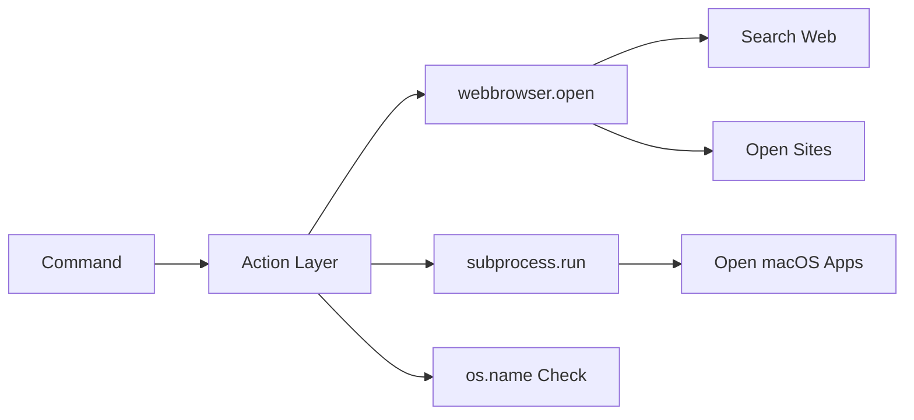

# AAA Personal Assistant

AAA Personal Assistant is a sophisticated voice-controlled application designed to streamline daily tasks through natural language interaction. Built with Python, it integrates advanced speech recognition and text-to-speech technologies to provide a hands-free user experience. The application features a professional terminal interface and a robust command-routing architecture.

## Project Overview

The project is structured to ensure modularity and scalability. It consists of a core processing engine, a voice interaction layer, and a professional user interface. The assistant listens for a specific wake word, "nova", before processing user requests, ensuring privacy and accidental trigger avoidance.

## System Features and Capabilities

| Feature | Description | Component |
|---------|-------------|-----------|
| Speech-to-Text | Converts live audio input into processed text strings. | voice/stt.py |
| Text-to-Speech | Provides audio feedback to the user via offline synthesis. | voice/tts.py |
| Command Routing | Patterns matching logic for identifying user intent. | core/command_router.py |
| Application Control| Ability to launch macOS applications via voice commands. | core/actions.py |
| Web Intelligence | Direct integration with web search engines for queries. | core/actions.py |
| Temporal Awareness| Functions to provide real-time date and time information. | core/actions.py |
| Professional UI | Rich-text terminal output with progress indicators. | core/ui.py |

## System Architecture



## Initialization Flow



## Main Execution Loop



## Speech Recognition Process



## Command Routing Logic



## Action Execution Flow



## Technical Stack

| Category | Technology | Purpose |
|----------|------------|---------|
| Language | Python 3.14 | Core logic and scripting. |
| Voice STT| SpeechRecognition | Audio processing and API interface. |
| Voice TTS| pyttsx3 | Offline audio synthesis. |
| UI | Rich | Professional terminal styling. |
| Connectivity| standard-aifc / chunk | Python 3.14 compatibility layers. |
| System | pyobjc | macOS native API bridging. |

## Configuration Parameters

| Parameter | Default Value | Description |
|-----------|---------------|-------------|
| WAKE_WORD | "nova" | The keyword required to trigger command processing. |
| WAKE_WORD_REQUIRED | True | Determines if the wake word is mandatory. |
| LANGUAGE | "en-US" | Language code for speech recognition. |
| LISTEN_TIMEOUT | 6 | Seconds to wait for audio before timing out. |
| PHRASE_TIME_LIMIT | 7 | Maximum length of a single spoken phrase. |
| AMBIENT_NOISE_SECONDS | 0.8 | Duration for background noise calibration. |

## Sample Commands and Actions

| Command Category | Examples | Expected Result |
|------------------|----------|-----------------|
| System Controls | "nova stop", "nova exit" | Application terminates gracefully. |
| Information | "nova what is the time" | Current local time is spoken. |
| Applications | "nova open chrome", "nova open notes" | Corresponding app is launched. |
| Web Search | "nova search for space travel" | Default browser opens a search result. |
| Navigation | "nova open youtube" | Browser navigates to the URL. |

## Installation and Usage

1. Clone the repository to your local machine.
2. Ensure PortAudio is installed (macOS: `brew install portaudio`).
3. Initialize the Python virtual environment:
   ```bash
   python3 -m venv .venv
   source .venv/bin/activate
   ```
4. Install the required dependencies:
   ```bash
   pip install -r requirements.txt
   ```
5. Run the assistant:
   ```bash
   python assistant.py
   ```
